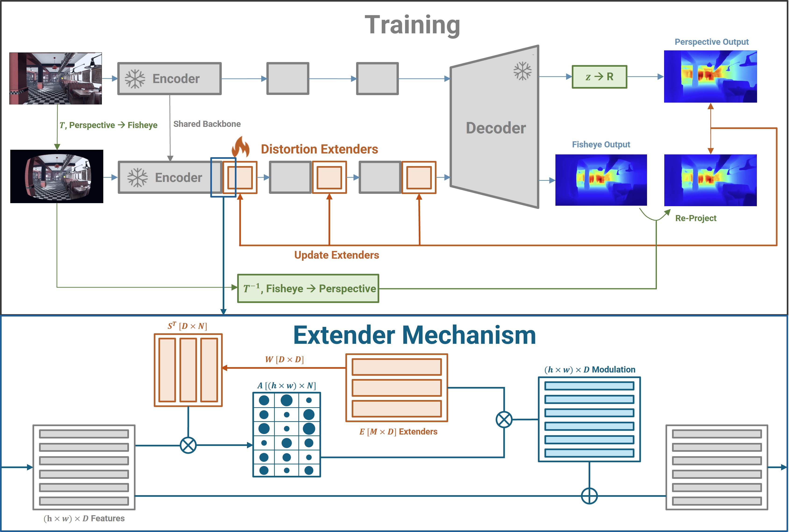

# Distortion Extenders (DEX)
### From Perspective to Fisheye Depth Estimation and Open-Vocabulary Segmentation [ECCV 2026]

[📄 arXiv](https://arxiv.org/abs/2608.27860) | [📑 Paper (PDF)](https://arxiv.org/pdf/2608.27860) | [🖼️ Poster](https://eccv.ecva.net/media/PosterPDFs/ECCV%202026/4568.png?t=1788807895.2004554)


---

> **Coming soon:** This release currently covers the training and evaluation protocols for **monocular depth estimation**. Code for open-vocabulary segmentation will be released soon.

## Overview

Vision foundation models trained on large-scale perspective imagery return erroneous outputs on wide field-of-view (fisheye) images, because radial distortion causes a covariate shift in their latent embeddings. We introduce **Distortion Extenders (DEX)**, a set of lightweight learnable parameters that model the fisheye distortion coefficients and the distributional shift between fisheye and perspective images in latent space. DEX is inserted into each block of a **frozen** backbone and modulates its features, so no backbone weights are fine-tuned and no rectification or calibration is needed at test time.

Each layer's features select a convex combination of the Extenders (via a low-rank selection matrix), which is added back to the features to translate fisheye embeddings toward the distribution of perspective embeddings.



Given a calibrated perspective image and its synthetically distorted fisheye counterpart, DEX is trained in a self-supervised manner: the fisheye output is mapped back to the perspective frame with the inverse distortion transform and aligned to the frozen perspective prediction. No ground truth or real fisheye images are required. For depth, DEX also predicts in spherical range (Euclidean distance R) rather than Cartesian depth z, which better handles high-FoV fisheye. DEX is architecture- and task-agnostic (convolutional and Transformer backbones; depth and open-vocabulary segmentation), and its activations can be decoded to distortion coefficients for camera calibration.

This work builds upon [Calibration Tokens](https://github.com/Suchisrit/CalibrationTokens) (ICCV 2025).

Supported backbone depth models:
- **UniDepth** (default)
- **Depth Anything**
- **MiDaS**

The Extenders are injected into the encoder forward pass of each backbone. If you want to apply this to a new model, the relevant files to reference are:

| Backbone | File |
|---|---|
| UniDepth | `external_src/monocular_depth/UniDepth/unidepth/models/backbones/dinov2.py` |
| Depth Anything | `external_src/monocular_depth/Depth_Anything/torchhub/facebookresearch_dinov2_main/vision_transformer.py` |
| MiDaS | `external_src/monocular_depth/MiDaS/midas/backbones/vit.py` |

---

## Environment Setup

Uses **Python 3.8** and a CUDA-capable GPU (tested on CUDA 11.8).

### 1. Create and activate a virtual environment

```bash
virtualenv -p /usr/bin/python3.8 ./dex_env
source ./dex_env/bin/activate
```

### 2. Pin typing-extensions for Python 3.8 compatibility

`typing-extensions` 4.13+ requires Python 3.9. Pin it first so PyTorch's installer does not upgrade it:

```bash
pip install "typing-extensions<4.13.0"
```

### 3. Install PyTorch with CUDA support

```bash
pip install torch==2.2.0+cu118 torchvision==0.17.0+cu118 torchaudio==2.2.0+cu118 --index-url https://download.pytorch.org/whl/cu118
```

> For CUDA 12.1, replace `cu118` with `cu121` throughout.

### 4. Install xformers (required by UniDepth)

```bash
pip install xformers==0.0.24 --index-url https://download.pytorch.org/whl/cu118
```

### 5. Install remaining dependencies

```bash
pip install -r requirements.txt
```

---

## Pretrained Model Checkpoints

### DEX checkpoints

The trained Distortion Extenders (12 Extenders per block) for each backbone are hosted on HuggingFace at [Rit888/DEX](https://huggingface.co/Rit888/DEX). Download them into `checkpoints/`:

```
checkpoints/
├── dex_unidepth.pth
├── dex_midas.pth
└── dex_depthanything.pth
```

```bash
huggingface-cli download Rit888/DEX --local-dir checkpoints
```

### Backbone weights

Download the backbone model weights and place them under `model_ckpt/`:

```
model_ckpt/
├── dpt_large_384.pt            # MiDaS ViT-Large
└── depthanything/
    ├── depth_anything_vitl14.pth
    ├── depth_anything_vitb14.pth
    └── depth_anything_vits14.pth
```

**MiDaS** weights (from [isl-org/MiDaS](https://github.com/isl-org/MiDaS)):

| File | Link |
|---|---|
| `dpt_large_384.pt` | https://github.com/isl-org/MiDaS/releases/download/v3/dpt_large_384.pt |

**Depth Anything** weights (from [LiheYoung/Depth-Anything](https://github.com/LiheYoung/Depth-Anything), hosted on HuggingFace):

| File | Size | Link |
|---|---|---|
| `depth_anything_vitl14.pth` | 1.34 GB | https://huggingface.co/spaces/LiheYoung/Depth-Anything/resolve/main/checkpoints/depth_anything_vitl14.pth |
| `depth_anything_vitb14.pth` | 390 MB | https://huggingface.co/spaces/LiheYoung/Depth-Anything/resolve/main/checkpoints/depth_anything_vitb14.pth |
| `depth_anything_vits14.pth` | 99.2 MB | https://huggingface.co/spaces/LiheYoung/Depth-Anything/resolve/main/checkpoints/depth_anything_vits14.pth |

**UniDepth** weights are loaded automatically from HuggingFace Hub on first run.

---

## Dataset Setup

The training scripts expect a text file per dataset with one image path per line, and either a shared camera intrinsics `.npy` file or a per-image intrinsics list. Example usages are shown here, but you must create paths files for whatever data you choose to train on that match however your data is stored.

```
splits/
├── irs_images.txt          # one absolute/relative image path per line
├── waymo_images.txt
└── waymo_intrinsics.txt    # one .npy path per line (per-image intrinsics)

data/irs_derived/K.npy      # shared 3x3 intrinsic matrix for IRS
```

This shows an example usage with the IRS and Waymo datasets, but you will have to create your own splits/paths files.

These example datasets can be found at the following links:

| Dataset | Link |
|---|---|
| **IRS** (Indoor Robotics Stereo) | https://github.com/blackjack2015/IRS (download via [OneDrive](https://1drv.ms/f/s!AmN7U9URpGVGem0coY8PJMHYg0g?e=nvH5oB)) |
| **Waymo Open Dataset** | https://waymo.com/open/ |

---

## Training

### Single GPU

```bash
bash bash/train/train_unidepth.sh
```

### Multi-GPU (DDP)

```bash
bash bash/train/ddp_train_unidepth.sh
```

The DDP script launches with `torchrun --nproc_per_node=4` by default. Edit the script to change the number of GPUs, datasets, distortion ranges, or augmentation settings.

The training pipeline will multiply each dataset up to the size of the largest dataset, and repeatedly alternate through datasets at each step. `--n_batches_per_update` must be a multiple of the number of datasets, so each gradient update accumulates an equal number of batches from each dataset.

Key arguments:

| Argument | Description |
|---|---|
| `--model_name` | Backbone model: `unidepth`, `depthanything`, `midas` |
| `--num_extenders` | Number of Distortion Extenders to train per encoder block |
| `--output_reference_frame` | Reference frame the Extenders are trained to align to: `distance` (default, Euclidean distance R) or `depth` (raw z-depth). See the note below. |
| `--datasets` | Space-separated dataset tags (used for logging) |
| `--image_txts` | One `.txt` image list per dataset |
| `--intrinsics_paths` | One `.npy` (shared) or `.txt` (per-image) intrinsics file per dataset |
| `--crop_shapes` | `H W` pairs per dataset (try to use multiples of the patch size, which can be seen in model.py)  |
| `--k1_ranges` ... `--k4_ranges` | Radial distortion coefficient sampling ranges per dataset |
| `--dataset_weights` | Loss weight per dataset (default: 1.0) |
| `--n_batches_per_update` | Gradient accumulation steps |
| `--learning_rates` | Learning rates matching `--learning_schedule` |
| `--learning_schedule` | Epoch boundaries at which each learning rate applies |
| `--checkpoint_path` | Output directory for checkpoints and logs |
| `--n_step_per_checkpoint` | Save a checkpoint every N gradient update steps |
| `--n_step_per_summary` | Log to TensorBoard every N gradient update steps |
| `--restore_path` | Path to a checkpoint directory to resume from |
| `--enable_ddp` | Enable multi-GPU distributed training |

> **⚠️ Important — output reference frame (`--output_reference_frame`):** By default (`distance`), the reference perspective prediction is converted from z-depth to **Euclidean distance (R) from the camera center** before the alignment loss, so the Distortion Extenders are trained to produce depth in the **distance (R) reference frame**. If you instead want the Extenders to stay in the **raw z-depth reference frame**, set `--output_reference_frame depth`, which turns off this conversion. This choice changes what the trained Extenders (and therefore the model at inference) predict, so make sure it matches how you intend to use the outputs.

> **Note on step counting:** The step numbers printed in the log (e.g. `Step= 100 Losses=...`) and used for checkpointing correspond to **gradient update steps** (i.e. one weight update after accumulating `--n_batches_per_update` batches). The progress bar shown during training counts **individual data batches** across all datasets. These two counts will differ whenever `--n_batches_per_update > 1`.

Photometric augmentation arguments (all default to disabled):

| Argument | Description |
|---|---|
| `--aug_prob_brightness/contrast/saturation/hue/blur` | Per-augmentation probability |
| `--aug_brightness/contrast/saturation/hue/blur_range MIN MAX` | Sampling range for each augmentation |

---

## Evaluation

We evaluate zero-shot on real fisheye images: **ScanNet++** (indoor, KB distortion) and **KITTI-360** (outdoor). The split files are already in the repo under `splits/` (`scannetpp_test.txt`, `kitti360_test.txt`) along with the KITTI-360 validity mask (`kitti_360_mask.png`). You only need to set up the data under `data/`, which the scripts read relative to the repository root:

```
data/
├── scannetplusplus/
│   └── data/<scene>/dslr/
│       ├── resized_images/*.JPG        # fisheye DSLR images
│       └── colmap/cameras.txt          # OPENCV_FISHEYE intrinsics (fx fy cx cy k1 k2 k3 k4)
├── scannetplusplus_depth/
│   └── <scene>/dslr/render_depth/*.png # rendered z-depth in millimeters
└── KITTI-360/
    ├── RGB/*.png                       # fisheye images
    └── Depth/*.npy                     # rendered Euclidean distance maps (meters)
```

| Dataset | Link |
|---|---|
| **ScanNet++** | https://kaldir.vc.in.tum.de/scannetpp/ |
| **KITTI-360** | https://www.cvlibs.net/datasets/kitti-360/ |

The KITTI-360 images and distance maps of the split are hosted on HuggingFace at [Rit888/DEX_KITTI360_Eval](https://huggingface.co/datasets/Rit888/DEX_KITTI360_Eval), so they only need to be downloaded into `data/`:

```bash
huggingface-cli download Rit888/DEX_KITTI360_Eval --repo-type dataset --local-dir data
```

The ScanNet++ depth is rendered from the scene meshes (`data/<scene>/scans/mesh_aligned_0.05.ply` of the download) for the images in the split. This needs a GPU but no OpenGL:

```bash
python tools/render_scannetpp_depth.py \
  --data_root /path/to/scannetpp \
  --output_dir data/scannetplusplus_depth
```

ScanNet++ is evaluated in z-depth at 462 x 616 (the predicted distance is converted to z-depth with the fisheye model), and KITTI-360 in Euclidean distance at 700 x 700 on the 90 degree crops listed in the split file. Each prediction is averaged with the prediction of the horizontally flipped image, aligned to the ground truth with a per-image least squares scale and shift, and scored with RMSE and δ1 (threshold 1.25).

Run the evaluation for a backbone with:

```bash
bash bash/eval/eval_unidepth.sh
bash bash/eval/eval_midas.sh
bash bash/eval/eval_depthanything.sh
```

Or directly:

```bash
python eval.py \
  --num_extenders 12 \
  --checkpoint_path checkpoints/dex_unidepth.pth \
  --model_name unidepth
```

| Argument | Description |
|---|---|
| `--num_extenders` | Number of Distortion Extenders (must match the checkpoint) |
| `--checkpoint_path` | Path to the DEX checkpoint |
| `--model_name` | Backbone model: `unidepth`, `depthanything`, `midas` |
| `--datasets` | Datasets to evaluate: `scannetpp`, `kitti360` (default: both) |
| `--eval_shape` | `H W` for ScanNet++ (default `462 616`; use a multiple of the backbone patch size) |
| `--batch_size` | Evaluation batch size (default 8) |
| `--data_root` | Folder containing `scannetplusplus/`, `scannetplusplus_depth/` and `KITTI-360/` (default `data`) |

---

This software is property of Yale University, and is provided free of charge for research purposes only. It comes with no warranties, expressed or implied.


## Citation

```bibtex
@inproceedings{gangopadhyay2026perspective,
  title={From perspective to fisheye depth estimation and open-vocabulary segmentation},
  author={Gangopadhyay, Rit and Wong, Alex},
  booktitle={European Conference on Computer Vision},
  pages={245--265},
  year={2026},
  organization={Springer}
}
```
